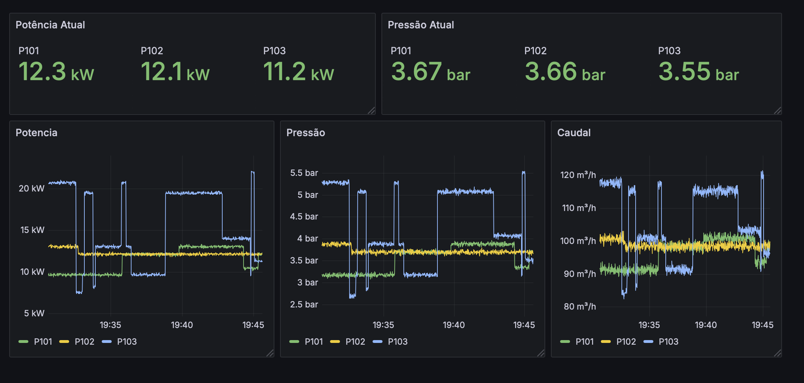

# OT Pump Station Pipeline

A small industrial data pipeline that simulates a pumping station and monitors it like a SCADA system: **simulator → MQTT → receiver → TimescaleDB → Grafana**.



## Architecture

```
simulador.py  ──MQTT──▶  Mosquitto  ──▶  recetor.py  ──SQL──▶  TimescaleDB  ──▶  Grafana
 (3 pumps)              (broker)       (subscriber)           (time series)     (dashboard)
```

## How it works

**Simulator (`simulador.py`, `bomba.py`)**
Three variable-speed pumps (P101–P103). Each pump is a Python class that keeps its own state (speed). Every second it produces a reading whose flow rate, pressure and power follow the **pump affinity laws** (flow ∝ speed, pressure ∝ speed², power ∝ speed³), with Gaussian noise to imitate real sensors. Every couple of minutes, on average, a pump changes speed, like a real control system adjusting to demand.

**Transport (MQTT)**
Each reading is published as JSON on its own topic (`estacao/P101/telemetria`, ...). MQTT follows the publish/subscribe pattern: the simulator does not know who consumes the data, so new consumers (database, alarms, dashboards) can be added without touching it. It is lightweight and widely used in IoT and OT.

**Receiver (`recetor.py`)**
Subscribes to `estacao/#`, converts each JSON message into a row and inserts it into the database using **parameterized queries**, which prevents SQL injection.

**Storage (TimescaleDB)**
PostgreSQL with time-series extensions. The `leituras` table is a hypertable partitioned by time, so queries such as "the last 15 minutes" stay fast as data grows. The schema is in `schema.sql`.

**Dashboard (Grafana)**
Time-series charts per pump and live indicators with alarm thresholds (yellow/red), refreshed every 5 seconds. The dashboard is versioned as code in `grafana/dashboard.json`.

## How to run

Requirements: Docker and Python 3.

**1. Start the broker, the database and Grafana**
```bash
docker run -d --name meu-mosquitto -p 1883:1883 eclipse-mosquitto:2.0.20 mosquitto -c /mosquitto-no-auth.conf

docker run -d --name minha-bd -p 5433:5432 \
  -e POSTGRES_PASSWORD=estacao -e POSTGRES_DB=estacao \
  -v minha-bd-dados:/var/lib/postgresql/data \
  timescale/timescaledb:2.17.2-pg16

docker run -d --name meu-grafana -p 3001:3000 \
  -v meu-grafana-dados:/var/lib/grafana grafana/grafana-oss:11.4.0
```

**2. Create the table**
```bash
docker exec -i minha-bd psql -U postgres -d estacao < schema.sql
```

**3. Install the Python dependencies**
```bash
python3 -m venv .venv
source .venv/bin/activate
pip install -r requirements.txt
```

**4. Run the pipeline (two terminals, both with the virtual environment active)**
```bash
python3 recetor.py
python3 simulador.py
```

**5. Open the dashboard**
- Go to http://localhost:3001 (user `admin` / password `admin`).
- Add a PostgreSQL data source: host `host.docker.internal:5433`, database `estacao`, user `postgres`, password `estacao`, TLS disabled, TimescaleDB enabled.
- Import `grafana/dashboard.json` (Dashboards → New → Import).

## What I learned

## What I learned

I'm an electrical engineer with a background in industrial automation and SCADA, moving into data engineering. I built this project step by step while learning Python, 
SQL and MQTT from scratch.

It taught me how a data project is structured end to end: generating data, moving it reliably between systems, storing it as time series and turning it into 
something an operator can use. At Efacec I had already worked with containers, but this project helped me understand how they actually work and how to connect them.

What I enjoyed most was seeing the physics I know from engineering, the pump affinity laws, show up as real data on a dashboard. That link between the plant floor 
and data is exactly the kind of work I want to do.